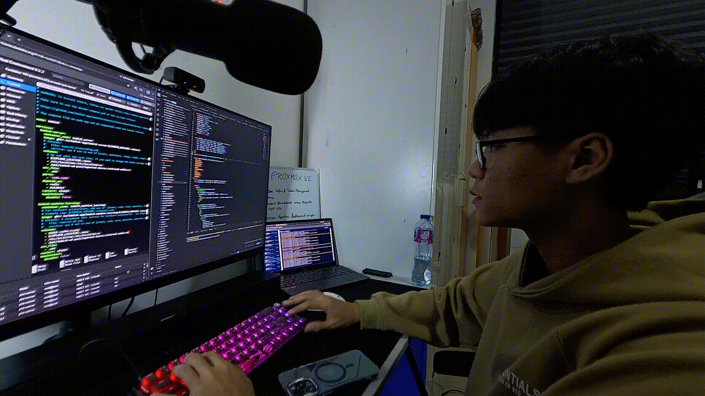

<p align="center">
  
</p>

<p align="center">
  
</p>

## 📌 About Me

> _Cloud Infrastructure, DevSecOps & Systems Engineer based in Dubai, UAE — bridging enterprise Windows/Linux administration, multi-cloud virtualization, SIEM/SOAR security operations, and sovereign AI workflow automation._

```yaml
# current_focus.yml
role: "Cloud Infrastructure, DevSecOps & Systems Engineer"
location: "Dubai, UAE"
cloudhost_engineering:
  - "Multi-cloud VM & storage orchestration (Proxmox VE, Microsoft Azure, Apache CloudStack)"
  - "Windows Server 2022 AD/GPO & enterprise IAM/secrets (Keycloak, OpenBao)"
  - "Zero-Trust mesh VPNs & perimeter firewall hardening (Tailscale, FortiGate, Sophos)"
  - "SIEM telemetry, threat detection & L1/L2 incident triage (Splunk, Wazuh SIEM)"
  - "Sovereign AI integrations automating enterprise CRM operational data flows"
sovereign_homelab:
  [
    "Bare-Metal Proxmox Cluster",
    "RHEL / Ubuntu / Debian",
    "Docker Compose",
    "Terraform & Ansible",
    "Grafana / Prometheus / Loki",
  ]
```

## Featured Engineering Projects

<table>
  <tr>
    <td width="50%" valign="top">
      <h3>☁️ omnicloud-infra-portal</h3>
      <p>Sovereign control plane and homelab operations center engineered to orchestrate bare-metal hypervisor telemetry, container orchestration, networking, and security operations.</p>
      <p><strong>Stack:</strong> <code>TypeScript</code> <code>React</code> <code>FastAPI</code> <code>Proxmox VE</code> <code>Wazuh SIEM</code></p>
      <a href="https://github.com/Ryan-Cangas/omnicloud-infra-portal">View Repository →</a>
    </td>
    <td width="50%" valign="top">
      <h3>🐳 docktor</h3>
      <p>TypeScript-powered container diagnostics, health inspection, and Docker operational management utility built for rapid troubleshooting across self-hosted clusters.</p>
      <p><strong>Stack:</strong> <code>TypeScript</code> <code>Docker</code> <code>Linux</code> <code>REST APIs</code></p>
      <a href="https://github.com/Ryan-Cangas/docktor">View Repository →</a>
    </td>
  </tr>
  <tr>
    <td width="50%" valign="top">
      <h3>📖 devsecops-runbooks</h3>
      <p>Production-ready DevSecOps runbooks, SIEM/SOAR security monitoring guides, incident triage SOPs, and infrastructure playbooks for homelab and enterprise environments.</p>
      <p><strong>Stack:</strong> <code>Splunk</code> <code>Wazuh SIEM</code> <code>Bash</code> <code>PowerShell</code> <code>Security Ops</code></p>
      <a href="https://github.com/Ryan-Cangas/devsecops-runbooks">View Repository →</a>
    </td>
    <td width="50%" valign="top">
      <h3>⚙️ proxmox-terraform-ansible-automation</h3>
      <p>Automated homelab infrastructure provisioning on Proxmox VE using Terraform for lightweight LXC root templates and dynamic DHCP, paired with Ansible for Docker and network service orchestration.</p>
      <p><strong>Stack:</strong> <code>Terraform (HCL)</code> <code>Ansible</code> <code>Proxmox VE</code> <code>Docker</code> <code>Linux</code></p>
      <a href="https://github.com/Ryan-Cangas/proxmox-terraform-ansible-automation">View Repository →</a>
    </td>
  </tr>
</table>

## Languages & Tools

> ### Virtualization & Cloud

<table align="center">
  <tr>
    <td align="center" width="115">
      <br />
      <sub><b>Proxmox VE</b></sub>
    </td>
    <td align="center" width="115">
      <br />
      <sub><b>CloudStack</b></sub>
    </td>
    <td align="center" width="115">
      <br />
      <sub><b>Docker</b></sub>
    </td>
    <td align="center" width="115">
      <br />
      <sub><b>AWS</b></sub>
    </td>
    <td align="center" width="115">
      <br />
      <sub><b>Azure</b></sub>
    </td>
  </tr>
  <tr>
    <td align="center" width="115">
      <br />
      <sub><b>Windows Server</b></sub>
    </td>
    <td align="center" width="115">
      <br />
      <sub><b>Linux</b></sub>
    </td>
    <td align="center" width="115">
      <br />
      <sub><b>RHEL</b></sub>
    </td>
    <td align="center" width="115">
      <br />
      <sub><b>Ubuntu</b></sub>
    </td>
    <td align="center" width="115">
      <br />
      <sub><b>Debian</b></sub>
    </td>
  </tr>
</table>

> ### Security, Networking & Identity

<table align="center">
  <tr>
    <td align="center" width="115">
      <br />
      <sub><b>FortiGate</b></sub>
    </td>
    <td align="center" width="115">
      <br />
      <sub><b>OPNsense</b></sub>
    </td>
    <td align="center" width="115">
      <br />
      <sub><b>Sophos</b></sub>
    </td>
    <td align="center" width="115">
      <br />
      <sub><b>Tailscale</b></sub>
    </td>
  </tr>
  <tr>
    <td align="center" width="115">
      <br />
      <sub><b>Wazuh SIEM</b></sub>
    </td>
    <td align="center" width="115">
      <br />
      <sub><b>Splunk</b></sub>
    </td>
    <td align="center" width="115">
      <br />
      <sub><b>Keycloak</b></sub>
    </td>
    <td align="center" width="115">
      <br />
      <sub><b>Nginx</b></sub>
    </td>
  </tr>
</table>

> ### Observability & IaC Automation

<table align="center">
  <tr>
    <td align="center" width="115">
      <br />
      <sub><b>Grafana</b></sub>
    </td>
    <td align="center" width="115">
      <br />
      <sub><b>Prometheus</b></sub>
    </td>
    <td align="center" width="115">
      <br />
      <sub><b>Loki</b></sub>
    </td>
    <td align="center" width="115">
      <br />
      <sub><b>Terraform</b></sub>
    </td>
    <td align="center" width="115">
      <br />
      <sub><b>Ansible</b></sub>
    </td>
  </tr>
</table>

> ### Backend & Development

<table align="center">
  <tr>
    <td align="center" width="115">
      <br />
      <sub><b>Python</b></sub>
    </td>
    <td align="center" width="115">
      <br />
      <sub><b>FastAPI</b></sub>
    </td>
    <td align="center" width="115">
      <br />
      <sub><b>Java</b></sub>
    </td>
    <td align="center" width="115">
      <br />
      <sub><b>TypeScript</b></sub>
    </td>
    <td align="center" width="115">
      <br />
      <sub><b>React</b></sub>
    </td>
  </tr>
  <tr>
    <td align="center" width="115">
      <br />
      <sub><b>Next.js</b></sub>
    </td>
    <td align="center" width="115">
      <br />
      <sub><b>Bash</b></sub>
    </td>
    <td align="center" width="115">
      <br />
      <sub><b>PowerShell</b></sub>
    </td>
    <td align="center" width="115">
      <br />
      <sub><b>Systemd</b></sub>
    </td>
    <td align="center" width="115">
      <br />
      <sub><b>REST APIs</b></sub>
    </td>
  </tr>
</table>

> ### Data, Crypto & Tools

<table align="center">
  <tr>
    <td align="center" width="115">
      <br />
      <sub><b>PostgreSQL</b></sub>
    </td>
    <td align="center" width="115">
      <br />
      <sub><b>MongoDB</b></sub>
    </td>
    <td align="center" width="115">
      <br />
      <sub><b>Libsodium.js</b></sub>
    </td>
    <td align="center" width="115">
      <br />
      <sub><b>Git</b></sub>
    </td>
    <td align="center" width="115">
      <br />
      <sub><b>VS Code</b></sub>
    </td>
    <td align="center" width="115">
      <br />
      <sub><b>Postman</b></sub>
    </td>
  </tr>
</table>

## 🔗 Connect with Me

<p align="center">
  <a href="https://www.linkedin.com/in/ryan-cangas" target="_blank">
    
  </a>&nbsp;
  <a href="mailto:cangasryanandre@gmail.com">
    
  </a>
</p>
